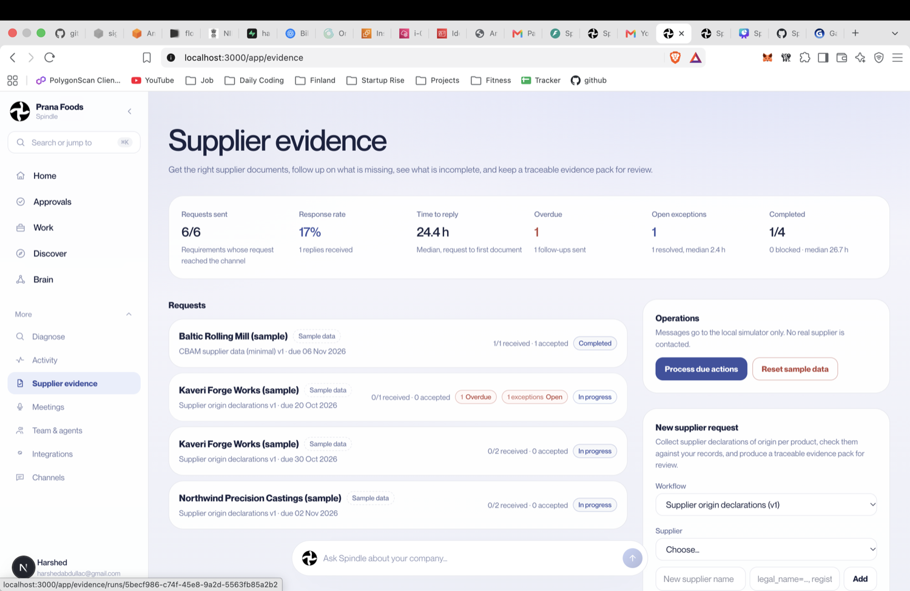

# Spindle Trade & Export

**Supplier documents, checked and organized before missing information delays a shipment.**

Spindle helps an operations team request supplier evidence, track what has arrived, compare invoice and packing-list fields, resolve gaps, and prepare a traceable report for human review. The workflow runs through Spindle’s shared company-scoped engine. It is not a separate agent or a legal-compliance product.

## The problem

Export teams often reconcile commercial invoices, packing lists, supplier declarations, and internal product records by hand. Missing fields and inconsistent values lead to email follow-ups, spreadsheet tracking, and late discovery of errors. The initial customer hypothesis is that reducing this reconciliation and coordination work saves time and prevents avoidable delays; that hypothesis still needs customer validation.

## What the prototype does

- Creates a company-scoped request for supplier documents.
- Tracks outstanding, received, incomplete, and reviewed evidence.
- Extracts available fields and compares documents using deterministic checks.
- Raises specific exceptions for missing or inconsistent information.
- Supports manual correction and human review with an audit trail.
- Produces a report that distinguishes received, extracted, checked, and reviewed evidence.
- Includes resettable **synthetic** suppliers, shipments, and documents for demos. Supplier messages in the prototype are simulated.

### Prototype screenshot



*Local prototype UI with synthetic sample data. Supplier messages are simulated; this screenshot does not represent a live production workflow.*

A consistent invoice and packing list means only **ready for review**. Spindle does not certify customs compliance, legal accuracy, HS classification, origin, or export readiness.

## Demo

- App: [app.heyspindle.com](https://app.heyspindle.com)
- Supplier evidence page: `/app/evidence` after signing in
- Synthetic sample data is labeled in the UI.

**Deployment status:** the web app is deployed, but the currently running AWS engine image predates the bundled evidence workflow module. The module and persistent-store configuration are implemented in the engine checkout and pass local tests; a new engine image still needs to be released before the hosted evidence page becomes operational. Do not present the hosted workflow as live until that release is verified.

## Architecture and tools

- **Web control centre:** Next.js, TypeScript, Supabase Auth, deployed on Cloudflare Workers.
- **Shared engine:** Python 3.12, FastAPI, Pydantic, company-scoped service authentication.
- **Workflow state:** SQLite plus content-addressed document storage on a persistent Docker volume for the prototype.
- **Checks:** deterministic field extraction and rule-based completeness/cross-document comparison.
- **Optional AI:** OpenAI-compatible JSON extraction through OpenAI or OpenRouter when configured. Extracted values are accepted only when the model supplies a quote found in the document; failures remain visible and retryable.
- **Human controls:** role-checked review and approval; supplier communication in this prototype is simulated.

## Run the local demo

This checkout is the Trade & Export module development/test harness. It pairs with the Spindle engine and web app checkouts.

```bash
cd ~/Startup/spindle-trade-export
make install
make check
make api
```

In another terminal, start the web app using its normal local setup and open `/app/evidence`. The engine reads its configuration from `spindle-agents-bootstrap/.env`; keep credentials out of this repository. The bundled production module lives in the engine at `src/spindle_agents/evidence/modules/trade_export`.

## Repository map

- `src/spindle_trade_export/`: workflow definitions, validators, and synthetic demo scenario.
- `tests/`: workflow and demo journey tests.
- `docs/PITCH_DECK.md`: six-slide pitch outline.
- `docs/AI_IMPACT_STATEMENT.md`: submission-ready impact statement (under 200 words).

## Roadmap

1. Release and verify the bundled workflow on the existing engine host.
2. Validate the pain and baseline workflow with export operations teams.
3. Measure time-to-complete, missing-document rate, follow-up effort, and exception-resolution time in a controlled pilot.
4. Add real supplier channels only with account linking, consent, authorization, and approval controls.

## License

Proprietary prototype. No license for redistribution is granted.
